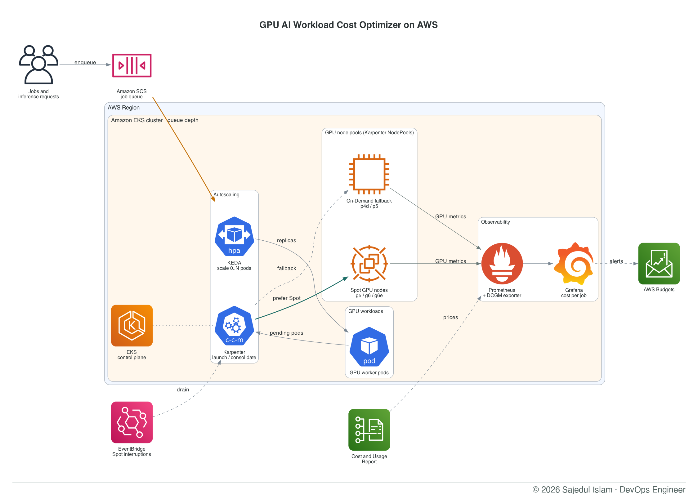

# GPU AI Workload Cost Optimizer

**Pay for GPUs only while they are doing work.**

A reference platform for running AI training and inference on Amazon EKS at a lower cost:
Spot and right-sized GPU nodes, scale-to-zero with Karpenter and KEDA, and cost-per-job dashboards in Prometheus and Grafana.


[](https://www.linkedin.com/in/sajedul-islam-devops)
[](https://calendly.com/sajedul-islam-devops/free-20-min-aws-cost-review)

> **Paying too much for GPUs on AWS?** [Book a free 20-minute AWS cost review](https://calendly.com/sajedul-islam-devops/free-20-min-aws-cost-review). We look at your GPU setup together and find where the money goes. No obligation.

---

## Contents

- [The problem](#the-problem)
- [The approach](#the-approach)
- [Architecture](#architecture)
- [How a job flows](#how-a-job-flows)
- [Roadmap](#roadmap)
- [Configuration examples](#configuration-examples)
- [Success measures](#success-measures)
- [Repository layout](#repository-layout)
- [Getting started](#getting-started)
- [Working on this repo with Claude Code](#working-on-this-repo-with-claude-code)
- [Security](#security)
- [Author and free cost review](#author)

---

## The problem

GPU bills grow faster than GPU usage. The usual causes:

| Cause | What happens |
|---|---|
| **Idle capacity** | GPU nodes stay up overnight, on weekends and between batches, billed whether a model runs or not. |
| **On-Demand by default** | Most clusters pay full On-Demand rates. AWS prices [Spot capacity at up to 90% below On-Demand](https://aws.amazon.com/ec2/spot/), but few teams use it for GPUs. |
| **Oversized instances** | A service that needs one 24 GB GPU lands on an 8-GPU node because that was the first instance type someone picked. |
| **No cost per job** | Finance sees one EC2 line item. Nobody can say what a training run or a million inference requests cost. |

## The approach

Four levers, applied together.

| Lever | What it does | Built with |
|---|---|---|
| **1. Price: Spot with fallback** | Runs interruption-tolerant work on Spot across several GPU families and AZs, falling back to On-Demand when Spot is scarce. | Karpenter NodePools, EventBridge + SQS interruption handling |
| **2. Fit: right-sized nodes** | Matches each workload to the smallest instance that meets its memory and throughput needs; shares GPUs for small models. | `g5` / `g6` / `g6e` for inference, `p4d` / `p5` for training, NVIDIA time-slicing or MIG |
| **3. Time: scale to zero** | Scales workers from queue depth down to zero; removes empty GPU nodes within minutes. | KEDA, Karpenter consolidation |
| **4. Visibility: cost per job** | Joins GPU allocation and utilization with live prices, so every job, team and model has its own cost line. | Prometheus, DCGM exporter, Grafana |

## Architecture



The diagram is generated from code: [`docs/diagrams/architecture.py`](docs/diagrams/architecture.py).

## How a job flows

1. A client puts a job or inference request on an **Amazon SQS** queue.
2. **KEDA** watches queue depth and scales GPU worker pods from **0 to N**.
3. New pods are pending, so **Karpenter** launches the cheapest GPU node that fits: **Spot first**, On-Demand as fallback.
4. If AWS reclaims a Spot node, **EventBridge** sends the notice through SQS and Karpenter drains it and replaces capacity.
5. The **DCGM exporter** reports GPU utilization to **Prometheus**; a pricing exporter adds the hourly price per GPU.
6. **Grafana** shows cost per job, per team and per model, and flags idle GPUs.
7. When the queue is empty, KEDA scales to zero and Karpenter **removes the empty nodes**. The GPU bill stops.

## Roadmap

Measurement comes first, so every later change is judged against a real baseline. Durations are indicative.

| Phase | Weeks | Goal | Deliverables |
|---|---|---|---|
| **1. Baseline and visibility** | 1–2 | Know current GPU-hours, utilization and spend | EKS GPU cluster, utilization dashboard, baseline cost report |
| **2. Spot and right-sizing** | 3–4 | Cut the price per GPU-hour | Karpenter NodePools, interruption handling, sizing guide |
| **3. Scale to zero** | 5–6 | Stop paying for idle time | KEDA ScaledObjects, consolidation policy, cold-start benchmarks |
| **4. Cost per job and guardrails** | 7–8 | Make cost visible and bounded | Cost-per-job dashboards, waste alerts, budget limits, before/after report |

- [ ] Phase 1: Baseline and visibility
- [ ] Phase 2: Spot and right-sizing
- [ ] Phase 3: Scale to zero
- [ ] Phase 4: Cost per job and guardrails

## Configuration examples

Everything is standard, reviewable Kubernetes configuration. No proprietary agent.

<details>
<summary><b>Karpenter NodePool</b>: Spot-first GPU nodes, removed when idle</summary>

```yaml
apiVersion: karpenter.sh/v1
kind: NodePool
metadata:
  name: gpu-inference
spec:
  template:
    spec:
      requirements:
        - key: karpenter.sh/capacity-type
          operator: In
          values: ["spot", "on-demand"]
        - key: karpenter.k8s.aws/instance-family
          operator: In
          values: ["g5", "g6", "g6e"]
      nodeClassRef:
        group: karpenter.k8s.aws
        kind: EC2NodeClass
        name: gpu
      taints:
        - key: nvidia.com/gpu
          effect: NoSchedule
  disruption:
    consolidationPolicy: WhenEmptyOrUnderutilized
    consolidateAfter: 5m
  limits:
    nvidia.com/gpu: 16
```
</details>

<details>
<summary><b>KEDA ScaledObject</b>: zero workers when the queue is empty</summary>

```yaml
apiVersion: keda.sh/v1alpha1
kind: ScaledObject
metadata:
  name: inference-worker
spec:
  scaleTargetRef:
    name: inference-worker
  minReplicaCount: 0
  maxReplicaCount: 8
  cooldownPeriod: 300
  triggers:
    - type: aws-sqs-queue
      metadata:
        queueURL: https://sqs.us-east-1.amazonaws.com/123456789012/inference-jobs
        queueLength: "5"
        awsRegion: us-east-1
      authenticationRef:
        name: keda-aws
```
</details>

<details>
<summary><b>PromQL</b>: dollars per hour each pod is costing</summary>

```promql
# node_price_per_gpu_hour_usd comes from the project's pricing exporter (planned)
sum by (namespace, pod) (
  kube_pod_container_resource_requests{resource="nvidia_com_gpu"}
  * on (node) group_left()
    node_price_per_gpu_hour_usd
)
```
</details>

## Success measures

Targets are set per environment after the Phase 1 baseline. These are the numbers the dashboards track from day one.

| Metric | What it shows | Direction |
|---|---|---|
| Cost per job | Dollars per training run or batch of inference requests | Down |
| Idle GPU-hours | Hours a GPU was billed with near-zero utilization | Toward zero |
| GPU utilization | Average SM activity on billed GPUs (DCGM) | Up |
| Spot share | Share of GPU-hours on Spot capacity | Up, where safe |
| Scale-up time | Seconds from first queued job to a ready GPU worker | Within SLO |

## Repository layout

```text
.
├── README.md
├── CLAUDE.md                     # project memory for Claude Code
├── .claude/
│   ├── settings.json             # shared permissions + hooks
│   ├── hooks/                    # safety and validation scripts
│   ├── skills/                   # repeatable procedures (Karpenter, KEDA, cost, diagram)
│   └── agents/finops-reviewer.md # cost-focused review subagent
├── docs/
│   ├── diagrams/architecture.py  # diagram source (AWS icons)
│   └── images/architecture.png
│
│   # planned
├── terraform/                    # VPC, EKS, IAM, SQS, interruption queue
├── k8s/
│   ├── karpenter/                # NodePools, EC2NodeClasses
│   ├── keda/                     # ScaledObjects, ScaledJobs, auth
│   └── monitoring/               # Prometheus, DCGM exporter, recording rules
├── dashboards/                   # Grafana JSON
└── examples/                     # sample inference and training workloads
```

## Getting started

> The platform code lands phase by phase. Today you can render the architecture and use the Claude Code setup.

**Prerequisites** (for later phases): AWS account with EKS permissions, `terraform` ≥ 1.6, `kubectl`, `helm`, and GPU instance quota in your Region (`g5`/`g6` Spot and On-Demand).

**Render the architecture diagram**

```bash
brew install graphviz
python3 -m venv .venv
.venv/bin/pip install diagrams pillow
.venv/bin/python docs/diagrams/architecture.py
```

## Working on this repo with Claude Code

This repo ships a shared [Claude Code](https://docs.claude.com/en/docs/claude-code/overview) setup, so every contributor's assistant follows the same rules.

| Piece | File | Purpose |
|---|---|---|
| **Memory** | [`CLAUDE.md`](CLAUDE.md) | Project facts, commands, conventions and safety rules, loaded every session. Personal notes go in `CLAUDE.local.md` (git-ignored). |
| **Permissions** | [`.claude/settings.json`](.claude/settings.json) | Pre-approves read-only checks (`terraform validate`, `kubeconform`); denies reading secrets and `~/.aws`. Personal overrides go in `.claude/settings.local.json` (git-ignored). |
| **Hooks** | [`.claude/hooks/`](.claude/hooks) | `block-dangerous-commands.sh` stops infrastructure-changing commands. `block-secrets.sh` stops keys and real account IDs from entering this public repo. `format-and-validate.sh` formats Terraform and validates YAML, JSON and shell after every edit. |
| **Skills** | [`.claude/skills/`](.claude/skills) | `karpenter-gpu-nodepool`, `keda-scale-to-zero`, `gpu-cost-per-job`, `architecture-diagram`. Claude loads one when a task matches, or run it as `/<skill-name>`. |
| **Subagent** | [`.claude/agents/finops-reviewer.md`](.claude/agents/finops-reviewer.md) | Read-only reviewer for cost waste, Spot risk and public-repo hygiene. Ask: "use finops-reviewer on my changes". |

Practices this setup follows:

- **Keep memory short.** `CLAUDE.md` holds facts and rules; procedures live in skills, which load only when needed.
- **Enforce with hooks, not prompts.** Anything that must never happen (deleting infrastructure, leaking keys) is a hook that exits with code 2, not a request in text.
- **Humans apply changes.** Claude writes and validates infrastructure code; a person reviews the plan and applies it.
- **Commit shared config, ignore personal config.** `.claude/settings.json` and `CLAUDE.md` are in git; `*.local.*` files are not.

Hook scripts need `jq`. Optional validators: `terraform`, `kubeconform`, `yamllint`, `shellcheck`.

## Security

- No credentials, account IDs or client data belong in this repo. Examples use `123456789012` and `us-east-1`.
- AWS access from workloads uses EKS Pod Identity or IRSA, never static keys.
- Report security issues privately to the maintainer rather than in a public issue.

## Author

**Md Sajedul Islam** · DevOps and FinOps engineer

- LinkedIn: [linkedin.com/in/sajedul-islam-devops](https://www.linkedin.com/in/sajedul-islam-devops)
- Free 20-minute AWS cost review: [book a time on Calendly](https://calendly.com/sajedul-islam-devops/free-20-min-aws-cost-review)

### Free 20-minute AWS cost review

Bring your current setup. In 20 minutes we cover:

- Where your GPU and EKS spend goes today
- Which workloads could run on Spot or smaller GPU instances
- Whether scale-to-zero fits your traffic
- A short list of next steps you can act on, with or without my help

[**Book your free call →**](https://calendly.com/sajedul-islam-devops/free-20-min-aws-cost-review)

If this project helps you or your team reduce GPU spend, a ⭐ helps others find it.
